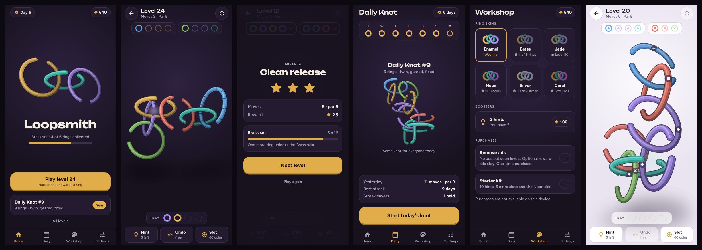

# Loopsmith

A 3D ring-untangle puzzle for Android and iOS, built with Flutter.



Turn each ring until its opening meets the link, slip it free, and land it on
the right peg. Rings that are not next on their peg wait in a four-slot tray;
a full tray ends the attempt.

"Loopsmith" is a working title. Check store and trademark availability before
you publish under it.

## Run it

```bash
flutter pub get
```

```bash
flutter run
```

Built and tested with Flutter 3.47.9 (Dart 3.13.7). The bundle id is the
placeholder `com.yourstudio.loopsmith`; change it before you publish.

## What is in the box

| Area | What you get |
|---|---|
| Levels | 300 campaign levels and 90 daily knots, every one proven solvable by the solver |
| Ring types | Plain, twin (two openings), geared pairs, fixed frames, sealed rings |
| Goals | Colour pegs in order, a four-slot holding tray, stars against par |
| Boosters | Hint (solver-driven), undo (first one free), extra tray slot |
| Screens | Home, play, level clear, tray full, daily knot, workshop, settings, level list |
| Progress | Coins, stars, six ring skins, a collectible set, daily streak with savers |
| Feel | 17 sound effects, three adaptive music layers, vibration, sparkles, camera that re-frames |
| Access | Light theme, colour-blind marks, left-handed layout, reduce motion, screen-reader labels |
| Money | Reward and between-level ads (AdMob), remove-ads and starter-kit purchases |
| Tests | 55 automated tests covering rules, solver, generator, saves, streaks, play flow and screens |

## How it is built

```
lib/
  game/       Rules, solver and level generator. Plain Dart, no Flutter.
  render/     The 3D ring painter, scene animation, touch, flights to pegs.
  screens/    Home, play, clear, daily, workshop, settings, level list.
  services/   Saves, audio, vibration, ads, store, analytics.
  ui/         Buttons, panels and other shared widgets.
assets/
  levels/     campaign.json and daily.json (generated).
  audio/      Sound effects (WAV) and music loops (MP3) (generated).
  fonts/      Unbounded and Figtree (SIL Open Font License).
tool/
  make_levels.dart   Regenerates the level packs.
  make_audio.py      Regenerates every sound.
  make_icons.py      Regenerates app icons for every platform.
```

### The 3D look without a 3D engine

Flutter has no production-ready 3D engine yet, and this game does not need
one. Each ring is cut into short segments, every segment is projected to the
screen, and all segments from all rings are painted far to near. That
ordering makes rings pass over and under each other correctly. See
`lib/render/knot_painter.dart` and `lib/render/scene.dart`.

Building and recording one frame of a 12-ring level takes about 1.5 ms on a
desktop CPU. It has not been profiled on a phone.

### Rules in one place

`lib/game/knot.dart` holds the rules. `lib/game/solver.dart` is a second,
compact implementation used for search; a test plays random moves through
both and checks they agree.

## Before you release

These need your own accounts, so they are left for you:

1. **Bundle id and signing.** Replace `com.yourstudio.loopsmith` in
   `android/app/build.gradle.kts` and in Xcode, and set up release signing.
2. **AdMob ids.** The project uses Google's public test ids, which only show
   test ads. Replace the app ids in `android/app/src/main/AndroidManifest.xml`
   and `ios/Runner/Info.plist`, and the ad unit ids in
   `lib/services/ads.dart`. In the AdMob console, block gambling and other
   sensitive categories.
3. **Store products.** Create two non-consumable products named `remove_ads`
   and `starter_kit` in Google Play Console and App Store Connect. Prices
   shown in the app come from the stores.
4. **Privacy.** Publish a privacy policy, fill in the store data-safety
   forms, and add Apple's App Tracking Transparency prompt if you want
   personalised ads on iOS. Google's consent form for the EEA and UK is
   already wired in.
5. **Analytics.** Events go through `lib/services/analytics.dart` and are
   only printed in debug builds. Add a Firebase (or publisher) implementation
   of that one class.
6. **Purchase validation.** Purchases are trusted on the device. Add
   server-side receipt checks before selling anything valuable.

## What has and has not been checked

Checked in the environment this was built in:

- `flutter analyze` reports no issues.
- All 55 tests pass, including one that plays every shipped level through
  the real play controller using its stored solution.
- The web build runs in Chromium: menus, play, pegs, tray, level clear and
  the tray-full card were exercised and inspected.
- Sound files were measured: no clipping, and each music loop repeats without
  a jump at the seam.

Not checked, because the tools were not available there:

- **No Android or iOS build was made.** The Android and iOS project settings
  follow each plugin's documentation but have not been compiled. Expect to
  fix small build issues on first run.
- **Nothing was tested on a real phone:** touch feel, frame rate, vibration
  and ads are unverified on device.
- **Nobody has listened to the audio.** It is synthesised by
  `tool/make_audio.py` and measured, not heard. Replace any file with a
  recording of the same name and the game will use it.

## Not included

- An online leaderboard for the daily knot (needs a backend). The daily
  screen shows your own results instead.
- Daily reminder notifications and weekly events.
- Oval and triangular frames. The fixed, squared frame is the one non-round
  ring type.
- Remote configuration. Every tunable number sits in
  `lib/game/economy.dart`, ready to move.

## Regenerating content

Levels (takes about six minutes; same output every time):

```bash
dart run tool/make_levels.dart
```

Audio:

```bash
pip install numpy scipy lameenc
```

```bash
python3 tool/make_audio.py
```

Icons:

```bash
pip install pillow
```

```bash
python3 tool/make_icons.py
```

The difficulty curve lives in `campaignSpec` in `lib/game/generator.dart`.

## Tests

```bash
flutter test
```
